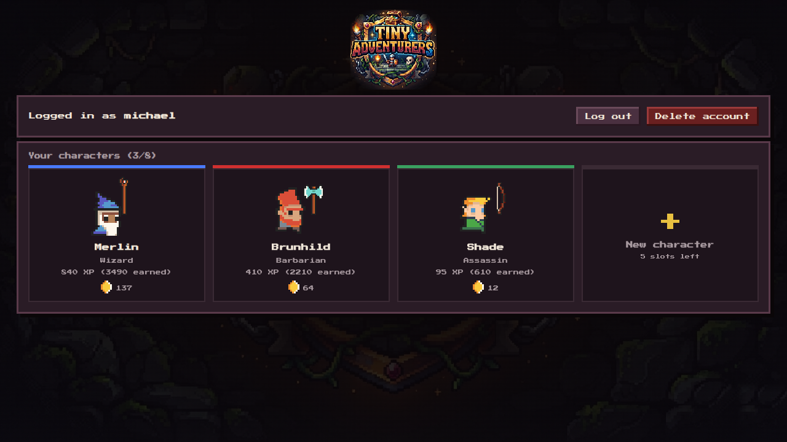
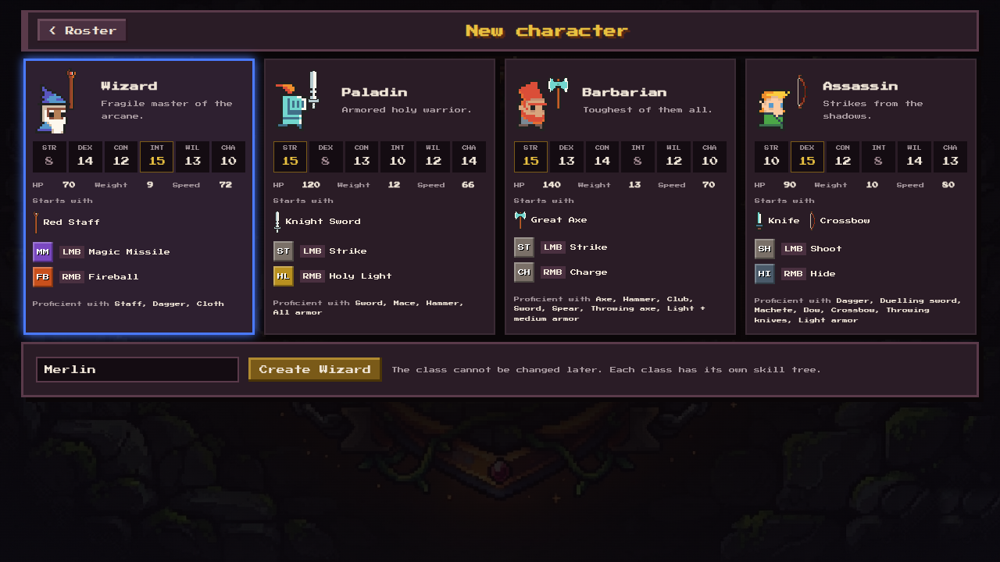
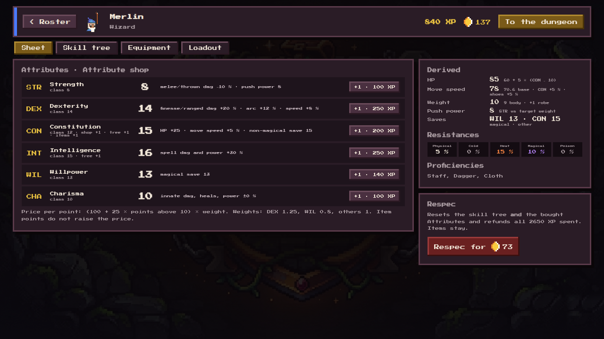
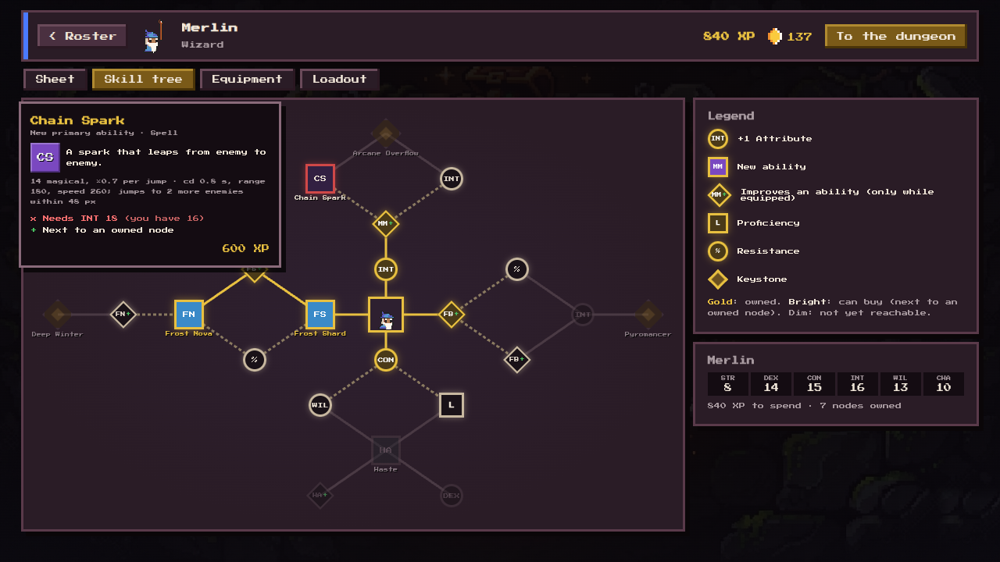
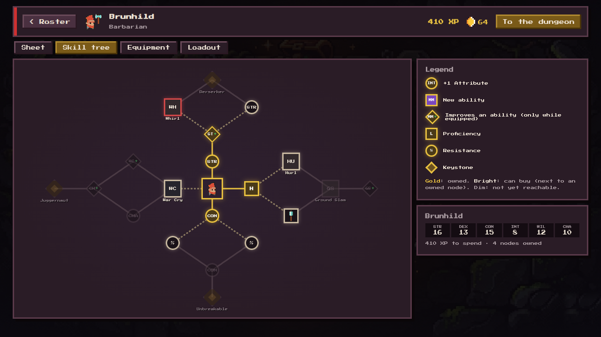
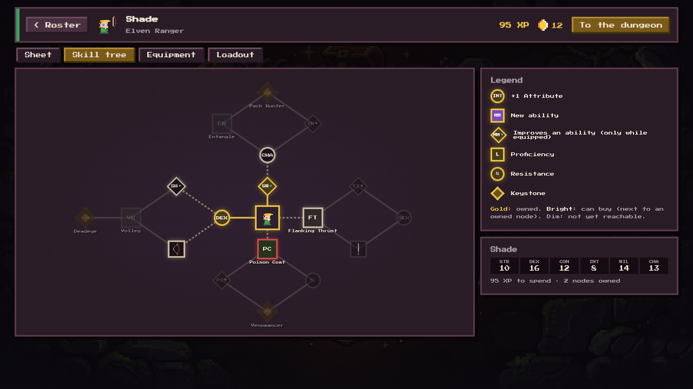
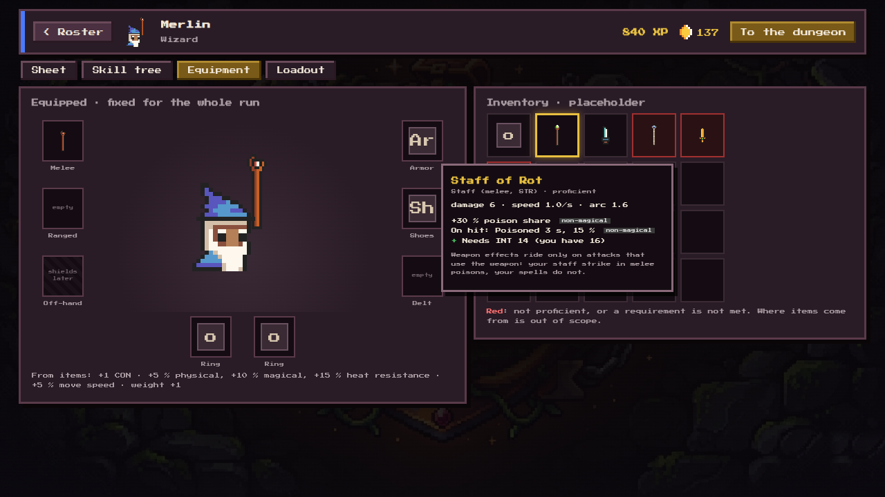
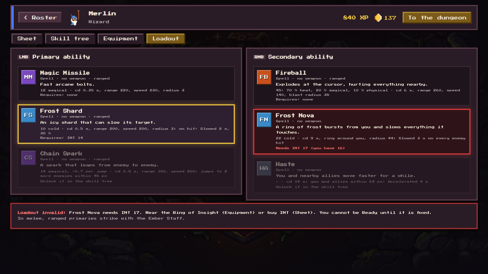

# Progression: Attributes, races, weapons and items, class skill trees, loadouts, new pre-run UI (TODO priority 4)

**Status:** spec, settled with the user on 2026-10-18 (brainstorming; decisions in [the brief](../plans/2026-10-18-progression-design-brief.md); the builder check's questions answered by the user the same day). **Updated 2026-10-19 after merging the [Elven Ranger](2026-10-16-elven-ranger-design.md)** (the Assassin became the Elven Ranger, Hide is gone, the Elf and Magical Beast races exist, the Dire Wolf is the first ally); see "Changes for the Elven Ranger" at the end. Marks: "(my call)" = decided by the agent; **the user approved all of them on 2026-10-18**; everything else is the user's. Next: an implementation plan (superpowers:writing-plans).

**Builds on:** [damage types and objects](2026-10-14-damage-types-and-objects-design.md) (resistances, `DamageSplit`, pushes), [effects](2026-10-15-effects-design.md) (effects, `OnHit`; responses since replaced by effect resistances, TODO 4b), [light sources](2026-10-15-light-sources-design.md) (`LightKind`), [vision](2026-10-15-vision-darkvision-design.md) (sight per entity type).

**Mock screens:** `?uidemo=<screen>` (throwaway spike in `client/src/uidemo/`, mock data, no server). Screenshots: `tools/e2e/ui-shots.mjs` into `img/2026-10-18-progression/`. The ability and tree tables below are printed from the spike's `uidemo/data.ts` (`cd client && npx tsx src/uidemo/spec-tables.ts`), so the pictures and the tables agree.

## Goal

Replace the five XP stat upgrades with a character build:
- six D&D-like **Attributes** (bought with XP, raised by tree nodes and items);
- **races** (today's entity types, made D&D-like);
- **weapons and items** that carry the damage, speed, arc and effects of attacks;
- one **skill tree per class** (a node graph bought with XP) with **16 new abilities**;
- a **loadout**: one primary (LMB) and one secondary (RMB) ability per run;
- a **new pre-run UI**: roster, create, a character hub with four tabs, and a waiting room that shows loadouts.

One **character sheet**, built at run start from all of these, is the only thing the simulation reads. At the class's starting Attributes the game plays like today (calibration, with the few listed exceptions).

**Not in scope:** item sources (drops, coin shop, rarities, inventory size), elite templates for enemies, the balancing pass (TODO priority 18), shields (the off-hand slot is reserved).

## Terms

- **Attribute:** STR, DEX, CON, INT, WIL, CHA. The UI and the code never say "ability score".
- **Ability:** only an LMB **primary** or RMB **secondary** ability. "Ability" never means an Attribute.
- **Attribute shop:** where XP buys Attribute points (the Sheet tab).
- **Race:** what `EntityType` becomes (damage and effect resistances, sight, bonuses, natural attack).
- **Weapon kind** (Sword, Bow, …) and **weapon category** (Melee, Finesse, Ranged, Thrown, Natural).
- **Sheet:** the resolved numbers of one hero or enemy for one run.

## 1. Attributes (`server/src/defs/attributes.rs`, new)

```rust
#[derive(Clone, Copy, PartialEq, Eq, Hash, Serialize, Deserialize, TS)]
pub enum Attr { Str, Dex, Con, Int, Wil, Cha }          // ALL, COUNT = 6
#[derive(Clone, Copy, Default, PartialEq, Serialize, Deserialize, TS)]
pub struct Attributes([i32; Attr::COUNT]);              // get(a), add(a, n), plus(other)
pub const BASELINE: i32 = 10;                            // every effect is linear around 10
```

- **No dice, no caps:** no maximum for heroes or enemies. Values below 10 give negative effects.
- **Every point counts:** effects are linear per point above or below 10, no D&D half-steps (my call).

| Attribute | Effect per point above (below) 10 |
|---|---|
| STR | Melee, thrown and natural-attack damage ±5 %. Push power (§4). Range and projectile speed of ranged weapons ±2 % each (my call: the brief named the effect, not the size). |
| DEX | Finesse and ranged weapon damage ±5 %. The arc of **every** melee attack ±3 %. Melee attack speed and ranged firing speed ±2 %. Through damage it sets how far shots pierce (§6.5). |
| CON | HP ±5. Move speed ±1 % (the user's idea, added after the brief; the size is my call). The save against non-magical effects. |
| INT | Spell damage ±5 %. Spell effect power (the power in §5). |
| WIL | The save against hostile magical effects: shorter duration only, never less damage. |
| CHA | Innate magic: damage and heals ±5 %, effect power, auras. Later also prices and NPCs (not now). |

**Not DEX:** move speed, blast damage reduction (dropped), projectile speed and range, thrown damage.

- **Helpers** in `attributes.rs`, so every formula lives in one place: `factor(v, pct) = 1 + pct × (v − 10)` (floored at 0.1, my call, so a very low value never gives zero or negative damage), `hp(base, con) = base + 5 × (con − 10)`.
- **Two layers that never mix:**
  - **Resistances** (% per damage type) reduce damage. They come from the race, the entity's own adjustment, items and tree nodes (and effects, as today).
  - **Attributes** do everything else and never touch resistances.
  - Armor's damage reduction is physical resistance. The XP "Armor" upgrade is removed.

**Class start Attributes** (my call: all four use the standard array 15, 14, 13, 12, 10, 8, counted with the race bonus):

| Class | STR | DEX | CON | INT | WIL | CHA | Base HP + 5×(CON−10) = HP | Weight | Move speed |
|---|---|---|---|---|---|---|---|---|---|
| Wizard | 8 | 14 | 12 | 15 | 13 | 10 | 60 → 70 | 9 | 72 |
| Paladin | 15 | 8 | 13 | 10 | 12 | 14 | 105 → 120 | 12 (+ armor) | 66 |
| Barbarian | 15 | 13 | 14 | 8 | 12 | 10 | 120 → 140 | 13 | 70 |
| Elven Ranger | 10 | 13 + 2 (Elf) = 15 | 12 | 8 | 14 | 13 | 80 → 90 | 10 | 80 |

`ClassDef` loses `hp`, `primary`, `secondary` and gains `attrs`, `base_hp`, `weight`, `starter: Equipment`, `start_loadout`, `proficiencies`, `tree`. `speed` stays as the class base (worked back, §1.1). **Move speed** = class or race base × the CON factor; besides CON, only shoes, tree nodes and effects change it.

### 1.1 Calibration (my call)

At the class's starting Attributes and starter equipment, every hero number equals today's. Base values are worked back: `base = today / factor(start value)`. Examples:

| Number | Today | Start factor | Base in the data |
|---|---|---|---|
| Magic Missile damage | 12 | INT 15: ×1.25 | 9.6 |
| Fireball damage | 45 | INT 15: ×1.25 | 36 |
| Holy Light heal | 35 | CHA 14: ×1.20 | 29.17 |
| Knight Sword damage / cooldown / arc | 20 / 0.45 s / 1.75 | STR 15: ×1.25; DEX 8: speed ×0.96, arc ×0.94 | 16 / 0.432 s / 1.862 |
| Great Axe damage / cooldown / arc | 32 / 0.8 s / 2.45 | STR 15: ×1.25; DEX 13: speed ×1.06, arc ×1.09 | 25.6 / 0.848 s / 2.248 |
| Elven Bow damage / cooldown / range, speed | 16 / 0.7 s / 260, 290 | DEX 15: ×1.25, speed ×1.10; STR 10: ×1 | 12.8 / 0.77 s / 260, 290 |
| Rapier (auto-thrust) damage / cooldown | 18 / 0.35 s | DEX 15: ×1.25, speed ×1.10 | 14.4 / 0.385 s |
| Move speed: Wizard / Paladin / Barbarian / Elven Ranger | 72 / 66 / 70 / 80 | CON 12 / 13 / 14 / 12: ×1.02 / ×1.03 / ×1.04 / ×1.02 | 70.59 / 64.08 / 67.31 / 78.43 |

**Accepted differences** (listed in the calibration test as exceptions):
- **Charge** = the weapon's damage × 0.8 (the brief's call) = 25.6, today 25.
- **Melee reach** belongs to the body, not the weapon (there is no reach stat): hero reach = `HERO_REACH` 17 + body radius 5 = 22 (my call). The Sword and the rapier stay at 22; the **Great Axe drops from 25 to 22**. Enemies keep their current per-type melee range as a body value in their stat block (the ogre and the demon still reach further).
- **Effect durations** change by design through §5 (for example the lich's Sleep mist on the Paladin lasts ×1.5). Base durations stay today's.
- **Pushes** change by design through §4 (a Barbarian is pushed less than a Wizard).

Balancing all of it is TODO priority 18.

## 2. Growth: Attribute shop, tree XP, respec

- **Attribute shop** (XP): price of the next point = `(100 + 25 × max(0, current − 10)) × weight[attr]`, rounded.
  - `current` is the value **without items** (class + shop + tree), so a ring never raises prices (my call).
  - **Weights** live in one data table in `attributes.rs`: `ATTR_WEIGHT = [Str 1.0, Dex 1.25, Con 1.0, Int 1.0, Wil 0.8, Cha 1.0]`. DEX is worth the most per point (+7 % damage per second for its own builds, plus speed and arc for every weapon user); WIL the least. The user may add WIL-based abilities later and re-weight.
  - **Watch CON** (an honest note, not a change): with HP, its save and now move speed, CON is the best all-round buy for every class. If play shows everyone pumping CON, raise its weight (for example to 1.1) in the balancing pass.
- **Tree nodes** cost XP directly. There are no character levels and no skill points.
- **Tree nodes and items can add Attribute points** too (they do not cost shop XP).
- **Respec** (coins): resets the tree **and** the bought Attributes, refunds all XP spent on both, and returns the character to the class start. Items stay; the loadout falls back to the class start abilities. Price: `20 + floor(xp_spent / 50)` coins (my call: grows with the XP spent).

## 3. Races (`defs/entity_types.rs` → `defs/races.rs`)

`EntityType` is renamed `Race`. **`Monster` is split** into Goblin, Orc, Ogre and Mimic; each keeps Monster's resistances (none) and darkvision (1/3).

```rust
pub enum Race { Human, Goblin, Orc, Ogre, Mimic, Undead, Demon, Dragon, Elf, MagicalBeast, Object }
pub struct RaceDef {
    pub res: Resistances,
    pub vision: f64, pub darkvision: f64,
    pub attrs: Attributes,                 // bonuses, added to the class or the stat block
    pub effect_res: EffectResistances,     // % per effect, after the save (§5); Elf, Magical Beast: Sleep 100 %
    pub natural: &'static [WeaponId],      // natural attacks; empty for Object
}
```

`Adjust` (an entity's own changes) stays as it is. `Profile` gains the race's natural attacks (its effect resistances are already there, TODO 4b).

| Race | Natural attack | Resistances, sight | Members |
|---|---|---|---|
| Human | Unarmed strike | as today | Heroes, necromancer, summoner, disciple |
| Goblin | Unarmed strike | none; vision 8, darkvision 1/3 | Goblin archer |
| Orc | Unarmed strike | as Goblin | Orc warrior, orc archer |
| Ogre | Unarmed strike | as Goblin | Ogre |
| Mimic | Bite | as Goblin | Mimic |
| Undead | Unarmed strike | as today | Skeletons, lich |
| Demon | Claws (20 % heat, as today's melee split) | as today | Imp, chort, Red Demon |
| Dragon | Bite, claws, tail | as today | Red Dragon |
| Elf | Unarmed strike | as today (10 % poison; vision 18, darkvision 1/3); **DEX +2**; Sleep resistance 100 % | Elven Ranger |
| Magical Beast | Bite (80 % physical, 20 % magical, as today's melee split) | as today (10 % poison, 10 % magical; vision 18, darkvision 1); Sleep resistance 100 % | Dire Wolf |
| Object | none | as today | Chests, barrels |

- **Attribute bonuses:** only the **Elf** has one: DEX +2 (the user, 2026-10-19). The Elven Ranger's class gives DEX 13, so her start total stays 15 and she plays like today. The other races have none (my call: the stat blocks in §7 already hold the final values); e.g. Undead CON +2 can come when a hero race needs it.
- **Effect resistances** (TODO 4b, built 2026-10-19): one % per effect, next to the damage resistances. The bosses' sit in their `Adjust` (`bosses.rs`); the race carries its own (`RaceDef.effect_res`): Elf and Magical Beast resist Sleep 100 %.
- The race's `melee: DamageSplit` moves to its natural weapons.

## 4. Weight and pushes

- Every entity has a **weight** (heroes, monsters, bosses, objects).
- A push happens only if the pusher's **STR is above** the target's weight. Distance = `base push × min(1, (STR − weight) / 4)` (my call).
  - The base push comes from the weapon (`push`), the ability (Charge, Ground Slam) or the blast.
  - **Blasts carry their own STR** (my call: barrel 18).
  - **Hero weight** = body + gear: armor adds weight, so heavy armor makes a hero harder to push.
- **Weights (my call):**
  - Heroes: the class table in §1 (plus armor).
  - Small enemies: imp 4, goblin 6, skeleton 9, chort 10. Humans (necromancer, summoner, disciple) 10.
  - Large enemies: orc 13, mimic 14, ogre 20.
  - Bosses: 40 (never pushed, as today). Chests 40 (never pushed). Barrel 6 (even the Wizard, STR 8, pushes it with E).
- `run.knock_player` and the monster push take `(pusher_str, target_weight)` and apply the formula. `KNOCK_DECAY` and `KNOCK_MIN_SPEED` stay.

## 5. Effects without dice

- **Duration** = `base × max(0, 1 + (power − save) / 20)` (my call).
  - **Power:** the source's key Attribute: INT for spells, CHA for innate magic; for non-magical effects the weapon wielder's key Attribute for that weapon (a poisoned blade), or the ability's stated power (War Cry: STR), or a fixed 10 for terrain (burning ground).
  - **Save:** WIL against magical effects, CON against non-magical ones.
  - A save 20 points above the power gives 0 s: the effect does not apply.
- **Effect resistance** (race, boss, items, tree nodes, effects) multiplies the time after the formula by `1 − r`; at 100 % the effect is refused. A damage-type effect (Burning, Frozen, Poisoned) has none of its own: its type's damage resistance resists it.
- **Effects from allies** (heals, buffs such as Haste) are never reduced.
- `OnHit` gains `magical: bool` and `power: i32` (filled by the sheet when the hit is built). `apply_effect_from` takes the power and reads the target's save and scales the time; `apply_effect` is unscaled (debug and tests).
- **Damage-type effects** (Burning, Frozen and so on, from a damage split; decided by the user, 2026-10-19): non-magical (save CON), at the power of the source's governing Attribute but never below 10: `max(10, governing)`. The Wizard's Fireball burns at INT, the imps', chorts', demon's and dragon's fire at CHA (innate), the summoner's fire bolt at INT (a spell), a hero's melee and the wolf's bite at STR, finesse and ranged weapons at DEX. Sources without one (lava, barrels, burning ground, effect ticks, a shot whose owner is unknown) stay at 10.
- **Cancels before resistance** (the user, 2026-10-19): an effect cancels its opposite even when the new effect is resisted (a fire hit on a creature that resists heat completely still thaws its ice).
- **Examples:** the Wizard's Sleep (INT 15) on a goblin (WIL 8) lasts ×1.35; the lich's Sleep mist (INT 22) on the Paladin (WIL 12) ×1.5. The Elven Ranger and her wolf never fall asleep (race Sleep resistance 100 %).

## 6. Weapons and abilities

### 6.1 Weapon kinds and categories (`defs/weapons.rs`, new)

Every weapon kind maps to a category in **one exhaustive `match`**, so a new kind without a category does not compile (the user requires this in the backend; no `_ =>` arm).

```rust
pub enum WeaponKind { Sword, Axe, Hammer, Mace, Club, Spear, Staff, Dagger, DuellingSword, Katana, Machete,
                      Bow, Longbow, Crossbow, ThrowingAxe, Unarmed, Bite, Claws, Tail }
pub enum WeaponCategory { Melee, Finesse, Ranged, Thrown, Natural }
pub fn category(k: WeaponKind) -> WeaponCategory { match k { /* every kind, no wildcard */ } }
pub fn key_attr(c: WeaponCategory) -> Attr  // Melee, Thrown, Natural: Str; Finesse, Ranged: Dex
```

| Category (key Attribute) | Kinds (sprites) |
|---|---|
| Melee (STR) | Sword (regular, knight, rusty, golden, lavish, red gem, anime, saw), Axe (axe, war axe, double axe, cleaver), Hammer (hammer, big hammer), Mace, Club (spiked baton), Spear, Staff (red, green, lich) |
| Finesse (**DEX only**) | Dagger (knife), duelling sword (rapier), katana, machete |
| Ranged (DEX) | Bow, longbow (bow_2), crossbow (uses the bow sprite) |
| Thrown (STR) | Throwing axe |
| Natural (STR, always proficient) | Unarmed, bite, claws, tail |

### 6.2 Weapon stats

```rust
pub struct MeleeStats  { damage: f64, speed: f64 /* attacks per s */, arc: f64, push: f64, split: DamageSplit, on_hit: Option<OnHit> }
pub struct RangedStats { damage: f64, speed: f64 /* shots per s */, range: f64, projectile_speed: f64, radius: f64,
                         projectile: EntityKind, split: DamageSplit, on_hit: Option<OnHit> }
```

- **Melee:** base damage, base speed (+2 %/DEX), base arc (×(1 + 3 %/DEX)), push, split, effects. **No reach stat** (§1.1: reach is the body's).
- **Ranged and thrown:** base damage, base firing speed (+2 %/DEX), base range and projectile speed (both +2 %/STR), split, effects.
- **Effects** on a weapon are item properties (§8): magical (flaming → a heat share, a light arrow) or non-magical (poisoned). **They apply only to attacks that use that weapon:** a flaming sword makes Strike and Charge burn, not Holy Light.
- **Torches:** "fire lights a torch" becomes "a hit with any heat share lights it", so a flaming sword lights torches too.

### 6.3 Abilities (`defs/abilities.rs`, rewritten)

```rust
pub enum AbilityCategory { WeaponAttack, Technique, Spell, Innate }
pub enum Uses { Melee, Ranged, Nothing }
pub enum Requirement { Attr(Attr, i32), WeaponKind(&'static [WeaponKind]) }   // shared with items and nodes
pub struct AbilityDef {
    pub id: AbilityId, pub slot: AbilitySlot /* Primary | Secondary */, pub category: AbilityCategory,
    pub uses: Uses, pub ranged: bool /* blocked in melee */, pub req: &'static [Requirement],
    pub shape: Shape,                 // Swing | Projectile | Blast | Ring | Dash | SelfArea | GroundArea | Buff | Summon
    pub own: OwnStats,                // spells and innate: damage, cooldown, range, speed, radius, duration, split, on_hit, light
    pub weapon_mult: WeaponMult,      // weapon attacks and techniques: damage ×, attack time ×, arc override, extra split
}
```

- **Weapon attacks and techniques** take damage, attack speed, arc or range, split and on-hit effects from the weapon they use, scaled by the weapon category's key Attribute, then by the ability's `weapon_mult`.
- **Spells** scale with INT, **innate abilities** with CHA, each with their own stats and split.
- **Requirements** use the same `Requirement` type as items and tree nodes. `WeaponKind` checks the slot the ability uses.
- **Today's abilities merge:** Sword and Axe → one generic **Strike**; CrossbowDagger → **Shoot** plus the auto-melee rule (§6.4); Dash → **Charge**; Heal → **Holy Light**. A new weapon then needs data and a sprite, not code.

| Class | Melee weapon | Ranged weapon | Primary (LMB) | Secondary (RMB) |
|---|---|---|---|---|
| Wizard | Red Staff (Staff) | – | Magic Missile (spell) | Fireball (spell) |
| Paladin | Knight Sword (Sword) | – | Strike | Holy Light (innate) |
| Barbarian | Great Axe (Axe; double axe sprite) | – | Strike | Charge (technique; weapon × 0.8) |
| Elven Ranger | Rapier (Duelling sword, finesse; `weapon_duel_sword`) | Elven Bow (Bow) | Shoot | Summon Wolf (innate) |

The Wizard's Red Staff is a new weapon (my call: damage 6 at STR 8 → base 6.67, 1.0 attack/s, arc 1.6, physical, no property). It matters only in melee (§6.4). The mock Wizard in the screenshots wears a found **Ember Staff** (the same with a flaming heat share and a light), to show weapon properties.

**Proficiencies per class** (my call; tree nodes add more):
- Wizard: staff, dagger; cloth.
- Paladin: sword, mace, hammer; all armor.
- Barbarian: axe, hammer, club, sword, spear, throwing axe; light and medium armor.
- Elven Ranger: dagger, duelling sword, machete, bow, crossbow; light armor (the longbow and the katana come from her tree).
- Natural weapons: always proficient.
- An item the character is not proficient with **cannot be equipped** (my call; shown red in the inventory).

### 6.4 The melee rule

- **Every ranged attack is blocked in melee, spells included** (the user).
- "Ranged" = delivered as a projectile or aimed at a distant spot (`AbilityDef.ranged`, my call). Self, aura, area, cone and dash abilities still work in melee: Holy Light, Summon Wolf, Nova, breath, Charge, Ground Slam, Frost Nova, Haste, War Cry, Purify, Consecrate, Poison Coat. Entangle is aimed at a distant spot, so it is ranged and blocked in melee.
- **Primary:** when an enemy is within melee reach (today's `dagger_target` test, at the hero's reach), a ranged primary switches to a **strike with the melee weapon**, or the natural attack if there is none. Its cooldown is that weapon's own. The Wizard then hits with his staff (the user accepts that he is weak in melee).
- **Secondary** (my call): a ranged secondary (Fireball) does not fire in melee and spends no cooldown; the client shows a short "Too close" hint on the slot.
- Enemies follow the same rule; it matches today's imp and chort, which claw when close.

### 6.5 Overkill piercing (ranged and thrown weapons only)

- A killing hit uses up only the damage needed to bring the target to 0 HP, **after its resistances**: `used = hp_left / Σ(share_t × (1 − res_t))`. The rest (`damage − used`) flies on to the next enemy. A hit that does not kill stops the shot.
- An **immune** target (the sum ≤ 0) stops the shot.
- In effect, DEX sets how far shots pierce.
- **Spell projectiles stop at the first enemy**, unless a tree node changes that (Piercing Missiles, §9).
- `Projectile` gains `pierce: Pierce { Never, Overkill { left: u8 /* u8::MAX = no limit */ } }` and `hit: SmallVec<[u32; 4]>` (ids already hit). The client's cosmetic copy (`GameScene.shotTouchesEnemy`) stops at the first enemy it cannot kill on its predicted HP, else continues (cosmetic only).
- This closes the "Piercing shots" idea in TODO "Progression follow-ups".

### 6.6 New abilities (2 primary + 2 secondary per class, 16 in all)

Each has a category, uses, requirements, stats, damage types and light from the start (TODO priority 4). Numbers are at the requirement's minimum and are starting values for the balancing pass. **Slowed** gets four sources (Frost Shard, Frost Nova, War Cry, Entangle), **Accelerated** two (Haste, War Cry).

| Class | Ability | Slot | Category | Uses | Blocked in melee | Requirements | Damage | Stats | Light |
|---|---|---|---|---|---|---|---|---|---|
| Wizard | **Frost Shard** | primary | Spell | none | yes | INT 14 | 10 cold | cd 0.5 s, range 200, speed 200, radius 3; on hit: Slowed 2 s, 35 % | Magic, tint 0x78c8ff (the FrostBolt kind) |
| Wizard | **Chain Spark** | primary | Spell | none | yes | INT 18 | 14 magical, ×0.7 per jump | cd 0.8 s, range 180, speed 260; jumps to 2 more enemies within 48 px | Magic (as the Missile) |
| Wizard | **Frost Nova** | secondary | Spell | none | no | INT 17 | 22 cold | cd 9 s, ring around you, radius 44; Slowed 3 s on every enemy hit | Magic, tint 0x78c8ff, 0.3 s flash |
| Wizard | **Haste** | secondary | Spell | none | no | INT 15, WIL 14 | – | cd 14 s; you and allies within 64 px: Accelerated 4 s | none |
| Paladin | **Judgement** | primary | Innate | none | yes | CHA 16 | 18 magical | cd 0.9 s, range 150, speed 220, radius 3 | Holy |
| Paladin | **Smite** | primary | WeaponAttack | melee | no | CHA 15, Sword or Mace or Hammer | weapon ×1.4, +30 % magical share | the weapon, attack time ×1.6 | Holy, 0.3 s flash on hit |
| Paladin | **Consecrate** | secondary | Innate | none | no | CHA 15 | 8 magical every 0.5 s | cd 12 s; ground circle at your feet, radius 40, 5 s | Holy, while it lasts |
| Paladin | **Purify** | secondary | Innate | none | no | WIL 14 | – | cd 15 s; you and allies within 64 px: negative effects removed, hostile magical effects resisted 100 % for 3 s | Holy, 0.3 s flash |
| Barbarian | **Whirl** | primary | Technique | melee | no | DEX 14 | weapon ×0.75 | full circle (arc 2π), attack time ×1.3 | the weapon |
| Barbarian | **Hurl** | primary | WeaponAttack | ranged | yes | Throwing axe | the throwing axe | the throwing axe (thrown: STR) | the weapon |
| Barbarian | **War Cry** | secondary | Technique | none | no | STR 16 | – | cd 12 s, radius 56: enemies Slowed 3 s (power STR, save CON), allies Accelerated 3 s | none |
| Barbarian | **Ground Slam** | secondary | Technique | melee | no | STR 17, Hammer or Club | weapon ×1.2 | cd 6 s, wind-up 0.5 s, radius 34 around you, pushes (STR) | the weapon |
| Elven Ranger | **Volley** | primary | WeaponAttack | ranged | yes | DEX 15, Bow or Longbow | weapon ×0.6 per arrow | 3 arrows in a 30° spread, attack time ×1.4 | the weapon |
| Elven Ranger | **Flanking Thrust** | primary | WeaponAttack | melee | no | DEX 16, Dagger or Duelling sword or Katana or Machete | weapon; ×2 from behind | the finesse weapon; "behind" = within 60° of the target's back | the weapon |
| Elven Ranger | **Entangle** | secondary | Innate | none | yes | CHA 14 | – | cd 14 s; roots at a spot within 120 px, radius 36, 4 s: enemies inside Slowed (power CHA, save WIL) | none |
| Elven Ranger | **Poison Coat** | secondary | Technique | none | no | WIL 15 | +30 % poison share | cd 16 s; 6 s: your weapon attacks add a poison share and Poisoned 3 s on hit | none |

Notes:
- **Projectiles:** Frost Shard reuses `EntityKind::FrostBolt` (cold, its light tint exists). Chain Spark and Judgement are new projectile kinds (Chain Spark: the Missile's look; Judgement: Holy light). Hurl uses its weapon's projectile (the throwing axe sprite); Volley fires three of the bow's arrows.
- **Strike** and **Shoot** show "the weapon" because their numbers come from the equipped weapon.
- **Chain Spark** jumps to the nearest enemy not yet hit within 48 px of the last target; damage ×0.7 per jump; jumps never return.
- **Purify**'s ward is a magical-effect resistance for 3 s (my call: a positive effect `Warded` whose mods are `Stat::ResistEffect(kind)` +1.0 for every magical negative effect, i.e. the effects saved with WIL; plan 3 fixes the exact set).
- **Consecrate** is a ground area like today's `FirePatch` (a new `EntityKind::HolyGround`), damaging enemies only.
- **Entangle** is a ground area like `FirePatch` (a new `EntityKind::Roots`, aimed like the Fireball) that slows enemies inside every 0.5 s (a 1 s Slowed, refreshed); it never hurts allies or the wolf.
- **Flanking Thrust** reads the target's facing: monsters already face their target, so an enemy busy with the wolf shows its back to the ranger.
- **The wolf's improvement nodes** (Thick Fur, Swift Pounce) are `AbilityMod`s on Summon Wolf: `CompanionHpMul(f64)`, `CompanionDashCooldownAdd(f64)`. Its other numbers stay fixed (the ranger spec's call 6).

## 7. Enemies

**Enemies have no classes** (the user asked; the answer was no). A **stat block** per enemy type is enough: Attributes, base HP, weight, weapons, proficiencies, abilities, reach. A template layer for elite variants can be added later as data. Their **AI stays as today**; `AttackStyle` keeps its shape and is filled at spawn from the stat block (weapon + Attributes), calibrated so today's numbers come out (§1.1).

**Enemy Attributes** (my call, loosely from the D&D Monster Manual):

| Enemy | Race | STR | DEX | CON | INT | WIL | CHA | Weight |
|---|---|---|---|---|---|---|---|---|
| Goblin archer | Goblin | 8 | 15 | 10 | 10 | 8 | 8 | 6 |
| Skeleton warrior | Undead | 12 | 12 | 15 | 6 | 8 | 5 | 9 |
| Skeleton archer | Undead | 10 | 15 | 13 | 6 | 8 | 5 | 9 |
| Raised skeleton / raised archer | Undead | as their originals, CON 12 | | | | | | 9 |
| Orc warrior | Orc | 16 | 12 | 16 | 7 | 11 | 10 | 13 |
| Orc archer | Orc | 14 | 14 | 14 | 7 | 11 | 10 | 13 |
| Necromancer | Human | 9 | 14 | 12 | 17 | 12 | 11 | 10 |
| Summoner | Human | 9 | 14 | 12 | 15 | 12 | 16 | 10 |
| Disciple | Human | 10 | 12 | 10 | 13 | 11 | 10 | 10 |
| Mimic | Mimic | 17 | 12 | 15 | 5 | 13 | 8 | 14 |
| Imp | Demon | 6 | 17 | 13 | 11 | 12 | 14 | 4 |
| Summoned imp | Demon | as the imp, CON 10 | | | | | | 4 |
| Chort | Demon | 14 | 13 | 13 | 8 | 10 | 9 | 10 |
| Ogre | Ogre | 19 | 8 | 16 | 5 | 7 | 7 | 20 |
| Red Demon (boss) | Demon | 22 | 14 | 20 | 14 | 16 | 20 | 40 |
| Lich (boss) | Undead | 10 | 14 | 14 | 22 | 18 | 16 | 40 |
| Red Dragon (boss) | Dragon | 24 | 10 | 22 | 16 | 14 | 20 | 40 |
| Dire Wolf (the ranger's ally) | Magical Beast | 17 | 15 | 15 | 3 | 12 | 7 | 10 |

**Enemy weapons and proficiencies** (from the sprites in `client/src/game/anim/defs.ts`):

| Enemy | Melee | Ranged | Spells (INT) / innate (CHA) / techniques | Proficiencies |
|---|---|---|---|---|
| Goblin archer | (unarmed) | Bow | – | Bow, dagger |
| Skeleton warrior / raised | Rusty sword | – | – | Sword |
| Skeleton archer / raised | (unarmed) | Longbow (bow_2) | – | Bow, sword |
| Orc warrior | Cleaver | – | – | Axe, club |
| Orc archer | (unarmed) | Bow | – | Bow, axe |
| Necromancer | Green staff | – | Shadow Bolt, Raise Dead (spells) | Staff, dagger |
| Summoner | Red staff | – | Fire Bolt (spell), Summon Imps (innate) | Staff, dagger |
| Disciple | Staff | – | Shadow Bolt (spell) | Staff |
| Mimic | Bite | – | – | – |
| Imp / summoned imp | Claws | – | Fire Bolt (innate) | – |
| Chort | Claws | – | Fire Bolt (innate) | – |
| Ogre | Spiked club | – | Ground Slam (technique, uses the club) | Club, hammer |
| Red Demon | Claws (cleave) | – | Swoop (technique), Ring of Fire (innate) | – |
| Lich | Lich staff | – | Gloom Bolt, Blinding Curse, Sleep Mist, Stone Gaze, Raise, Nova (spells) | Staff |
| Red Dragon | Bite, claws, tail | – | Fire Breath, Fireball (innate), Ground Smash (technique) | – |
| Dire Wolf | Bite | – | Dash (technique), Growl | – |

- **Enemy weapons are their own item defs** (my call: "Goblin Bow", "Orc Bow", … sharing sprites), so each enemy calibrates exactly even when two share a weapon kind with different numbers today (goblin bow 6, orc bow 10).
- **Enemy HP:** base HP = today's HP − 5 × (CON − 10), so the total stays. **Enemy move speed:** base = today's speed / the CON factor, so it stays too (bosses included, wherever their scripts read a speed).
- **The melee rule for enemies** (my call, from the user's "every entity always has a melee fallback"): an enemy whose only attack is ranged (archers, necromancer, summoner, disciple) switches to its melee weapon or natural attack when a hero is within its reach. **Unarmed strike** base stats (my call): damage 3 physical, 1.0 attack/s, arc 1.4, push 0, scaled by STR. This is new behaviour: run fingerprints change in step 4, deliberately. Imps and chorts already do this through `alt`; they keep it.
- **Bosses** (my call): their scripts in `run/bosses/*.rs` keep their constants and behaviour. The boss sheet supplies only HP, weight, Attributes (for effect power and saves) and effect resistances. The melee rule does not touch boss scripts. Moving boss attacks onto weapons is a later refactor, not this spec.
- **The Dire Wolf** (decided 2026-10-19) has a stat block in `defs/companions.rs` like an enemy's: race Magical Beast (with today's 20 % extra cold resistance as its `Adjust`), the Attributes above (my call, after the D&D dire wolf) and weight 10. They give its saves (WIL 12, CON 15) and its push power (STR 17: its bite and dash push an orc, not an ogre). Its HP (80), speed, bite and dash keep today's `WOLF_*` numbers: base HP and speed are worked back like an enemy's, they do not scale with the party, and its bite is not a weapon until plan 3. Only Thick Fur and Swift Pounce (§9) change it.
- Overkill piercing (§6.5) applies to enemies' ranged weapons too. Enemy projectiles today never pierce; with overkill they could kill a hero and fly on (rare; accepted).

## 8. Items (`defs/items.rs`, new; item sources out of scope)

```rust
pub enum EquipSlot { Melee, Ranged, OffHand, Armor, Ring1, Ring2, Shoes, Belt }
pub struct Equipment { pub slots: [Option<ItemId>; 8] }     // Melee is always Some (the class starter if empty)
pub enum ItemBase { Melee(WeaponKind, MeleeStats), Ranged(WeaponKind, RangedStats), Armor(ArmorStats), Ring, Shoes, Belt, Shield /* reserved */ }
pub struct ArmorStats { pub class: ArmorClass /* Cloth | Light | Medium | Heavy */, pub physical: f64, pub weight: f64 }
pub struct ItemDef { pub id: ItemId, pub name: &'static str, pub sprite: &'static str, pub base: ItemBase,
                     pub classes: &'static [ClassId],   // never empty: the classes that can use it (ClassId::ALL for everyone)
                     pub req: &'static [Requirement], pub props: &'static [ItemProperty] }
pub struct ItemProperty { pub kind: PropKind, pub magical: bool }
pub enum PropKind {
    DamageShare(DamageType, f64), OnHit(OnHit), Light(LightKind), Resist(DamageType, f64), Attr(Attr, i32),
    EffectResist(EffectKind, f64), Weight(f64), MoveSpeed(f64),
    Aura { radius: f64, grant: &'static PropKind },   // allies inside get `grant` (e.g. EffectResist, MaxHp)
    MaxHp(f64),
    GrantAbility { id: AbilityId, mods: &'static [AbilityMod], waive_attrs: bool },   // adds the ability to the loadout pool while worn
}
```

- **Slots:** melee weapon (always filled: the class starter), ranged weapon (optional), armor, ring ×2, shoes, belt, off-hand (reserved for shields; shown hatched).
- **Armor:** physical resistance %, weight, optional properties (magical examples: an aura that gives everyone in its radius 100 % resistance to an effect, or gives them more HP). Proficiency by `ArmorClass`.
- **Rings, shoes and belts** (the user): magical properties only. They are the ways to attach magical effects to a character for as long as they are worn: any `PropKind` (Attribute points, resistances, move speed, effect resistance, light, an aura, max HP). No potions and no consumables. Equipment is fixed for the run, so their effects hold for the whole run.
  - `ItemBase::Ring`, `Shoes` and `Belt` carry no stats of their own; an item def for one of these slots with a non-magical property fails a data test.
- **Extensibility:** a new item is one `ItemDef` entry; a new property is one `PropKind` variant plus its line in the sheet builder (one exhaustive `match`). The user wants an "object-oriented" backend; the repo's idiom is typed data in `defs/*.rs` with exhaustive matches, which gives the same safety without trait objects (traits only where they help, e.g. none needed here).
- **Items that grant abilities** (the user): `PropKind::GrantAbility(id)` adds an ability to the character's loadout pool **while the item is worn**. The pool = class start abilities + tree unlocks + abilities granted by equipped items.
  - **Class requirement on every item** (the user): `ItemDef.classes` lists one or more classes; every listed class can equip the item, no other can. It is never empty (a data test checks it); `ClassId::ALL` means everyone. Enemy weapons are not checked (enemies have no class).
  - **Each granting item gives its own version** (the user): the ability with that item's `mods` and that item's waiver, nothing else. Versions never merge. The pool holds one entry per source: the class or tree version ("Chain Spark") and one per granting item ("Chain Spark (Ring of Embers)"); the player picks one entry per slot.
  - **Requirements of a granted version** (the user): by default it keeps the ability's Attribute requirements (a ring granting Chain Spark works only at INT 18: access, not power). An item can **waive** them for its own version (`waive_attrs: true`). A waiver never carries over to another source's version: with two rings granting Chain Spark, one waiving and one not, the waiving ring's version is usable at any INT and the other stays red below INT 18. Weapon-kind requirements are never waived: an ability that uses a weapon slot needs that weapon to work (my call).
  - **Tree improvement nodes** for that ability apply to every version, whatever its source (approved).
  - **"The same ability" = the same `AbilityId`** (approved). Each ability is defined once in `abilities.rs`; unlock nodes, improvement nodes and items only reference the id, never copy it.
  - **Variants** (the user's preference): an item grants the base id with its own `mods` (for example "Chain Spark, +30 % heat share"), applied on top of the tree's improvements, only to that item's version. A separate `AbilityId` defined in `abilities.rs` stays possible for a truly different ability (then the base ability's tree improvements do not apply). An item never defines an ability inline.
  - **Stacking inside one version** (my call): tree improvements and the item's `mods` can change the same number. `AbilityMod` has only additive and multiplicative variants (no "set to"): additions are summed, multipliers multiplied, so the order never matters. If added damage shares push a split over 100 %, the added shares are scaled down so the total is 100 % (the base split is kept first).
  - Taking the item off removes that item's version from the pool (other versions stay); if it was in the loadout, the loadout turns invalid (red) until changed. Granting properties are magical.
- **Starter items:** each class's starter weapons (and no armor, my call, so calibration holds: today no hero has a resistance).
- **The Equipment tab** shows sample items (the spike's mock data). A debug-only `DebugGrantItem { item }` message (if the server allows debug) fills the inventory for testing (my call).

## 9. Skill trees (`defs/trees.rs`, new)

- **A fully separate tree per class**, a **branching node graph**: nodes connected by links, bought outward from the class start.
- **Buying a node:** it needs at least one owned neighbour (links are undirected), its requirements must be met (Attributes **with** items count, my call), and it costs XP. Owning is permanent until a respec.
- **Weapon requirements do not block buying** (the user): an unlock node for an ability that needs a weapon kind (Hurl, Volley, Ground Slam, Smite, Flanking Thrust) can be bought without that weapon. The ability can then only be **used** with the right weapon in the slot it uses: the loadout validation (§10) refuses it otherwise, and the Loadout tab shows it red. The node tooltip adds an amber line, for example "To use it: a throwing axe in the Ranged slot", and "(you have none)" when no such item is equipped or in the inventory.
- **Node kinds:** `+Attribute`; **ability unlock**; **ability improvement**, which works **only while that ability is equipped**; proficiency; resistance (my call: a separate kind, the resistances layer); keystone (a large, build-defining effect).

```rust
pub struct NodeDef { pub id: NodeId, pub class: ClassId, pub pos: (i8, i8), pub kind: NodeKind, pub name: &'static str,
                     pub cost: u32, pub req: &'static [Requirement], pub links: &'static [NodeId] }
pub enum NodeKind { Start, Attr(Attr, i32), Unlock(AbilityId), Improve(AbilityId, AbilityMod), Proficiency(Prof),
                    Resist(DamageType, f64), Keystone(Keystone) }
```

- `AbilityMod` (my call): a small enum of data changes (`Pierce(u8)`, `RadiusMul(f64)`, `DurationAdd(f64)`, `CooldownAdd(f64)`, `DamageMul(f64)`, `ArcMul(f64)`, `OnHitChance(f64)`, `AddOnHit(OnHit)`, `PushStr(i32)`, `BehindArc(f64)`, `CompanionHpMul(f64)`, `CompanionDashCooldownAdd(f64)`), applied by the sheet builder only to the equipped ability.
- `Keystone`: one enum variant per keystone, each handled in one place in the sheet builder or the run (for example `Berserker` is read by the damage code).
- **Positions** are grid coordinates (start at 0,0); the client draws the graph from them.
- **Totals:** a full tree costs about 8,500–10,400 XP (today maxing all five upgrades costs 21,875).

**Wizard** (22 nodes, 10360 XP in all)

| Id | x,y | Kind | Name | Effect | XP | Requires | Links to |
|---|---|---|---|---|---|---|---|
| `w0` | 0,0 | start | Wizard | Where the tree starts. Always owned. | 0 | – | `w_a1` `w_f1` `w_r1` `w_b1` |
| `w_a1` | 0,-1 | attr | +1 INT | +1 INT | 200 | – | `w_a2` |
| `w_a2` | 0,-2 | improve | Piercing Missiles | Magic Missile: pierces 1 enemy (overkill rule, like arrows). | 300 | INT 15 | `w_a3` `w_a4` |
| `w_a3` | -1,-3 | unlock | Chain Spark | Unlocks Chain Spark (primary). | 600 | INT 18 | `w_a5` |
| `w_a4` | 1,-3 | attr | +1 INT | +1 INT | 300 | – | `w_a5` |
| `w_a5` | 0,-4 | keystone | Arcane Overflow | Spell damage +15 %; spell cooldowns +10 %. | 1200 | INT 18 | – |
| `w_f1` | -1,0 | unlock | Frost Shard | Unlocks Frost Shard (primary). | 400 | INT 14 | `w_f2` `w_f3` |
| `w_f2` | -2,-1 | improve | Biting Cold | Frost Shard: Slowed chance 35 % → 100 %. | 350 | – | `w_f4` |
| `w_f3` | -2,1 | resist | Cold Blood | +20 % cold resistance. | 250 | – | `w_f4` |
| `w_f4` | -3,0 | unlock | Frost Nova | Unlocks Frost Nova (secondary). | 700 | INT 17 | `w_f5` |
| `w_f5` | -4,0 | improve | Wide Nova | Frost Nova: radius +25 %. | 400 | – | `w_f6` |
| `w_f6` | -5,0 | keystone | Deep Winter | Slowed enemies take +20 % cold damage from you. | 1200 | INT 17 | – |
| `w_r1` | 1,0 | improve | Bigger Bang | Fireball: blast radius +20 %. | 350 | – | `w_r2` `w_r3` |
| `w_r2` | 2,-1 | resist | Ember Skin | +20 % heat resistance. | 250 | – | `w_r4` |
| `w_r3` | 2,1 | improve | Scorched Earth | Fireball: the blast sets Burning (3 s) on everything it hits. | 500 | INT 16 | `w_r4` |
| `w_r4` | 3,0 | attr | +1 INT | +1 INT | 300 | – | `w_r5` |
| `w_r5` | 4,0 | keystone | Pyromancer | +20 % heat damage, −20 % cold damage. | 1200 | INT 17 | – |
| `w_b1` | 0,1 | attr | +1 CON | +1 CON | 200 | – | `w_b2` `w_b3` |
| `w_b2` | -1,2 | attr | +1 WIL | +1 WIL | 160 | – | `w_b4` |
| `w_b3` | 1,2 | prof | Light Armor | Proficiency: light armor. | 300 | – | `w_b4` |
| `w_b4` | 0,3 | unlock | Haste | Unlocks Haste (secondary). | 600 | INT 15, WIL 14 | `w_b5` `w_b6` |
| `w_b5` | -1,4 | improve | Lasting Haste | Haste: +2 s. | 350 | – | – |
| `w_b6` | 1,4 | attr | +1 DEX | +1 DEX | 250 | – | – |

**Paladin** (19 nodes, 9060 XP in all)

| Id | x,y | Kind | Name | Effect | XP | Requires | Links to |
|---|---|---|---|---|---|---|---|
| `p0` | 0,0 | start | Paladin | Where the tree starts. Always owned. | 0 | – | `p_u1` `p_l1` `p_r1` `p_d1` |
| `p_u1` | 0,-1 | attr | +1 CHA | +1 CHA | 200 | – | `p_u2` |
| `p_u2` | 0,-2 | improve | Greater Light | Holy Light: heal +25 %. | 350 | – | `p_u3` `p_u4` |
| `p_u3` | -1,-3 | unlock | Judgement | Unlocks Judgement (primary). | 600 | CHA 16 | `p_u5` |
| `p_u4` | 1,-3 | attr | +1 CHA | +1 CHA | 300 | – | `p_u5` |
| `p_u5` | 0,-4 | keystone | Radiant | Your innate abilities deal +20 % damage to Undead and Demons; you shed light 2 tiles. | 1200 | CHA 17 | – |
| `p_l1` | -1,0 | unlock | Purify | Unlocks Purify (secondary). | 500 | WIL 14 | `p_l2` `p_l3` |
| `p_l2` | -2,-1 | attr | +1 WIL | +1 WIL | 160 | – | `p_l4` |
| `p_l3` | -2,1 | resist | Warded | +20 % magical resistance. | 300 | – | `p_l4` |
| `p_l4` | -3,0 | improve | Lasting Ward | Purify: ward 3 s → 5 s. | 400 | – | `p_l5` |
| `p_l5` | -4,0 | keystone | Unshaken | Sleep resistance 100 %. | 1000 | WIL 16 | – |
| `p_r1` | 1,0 | improve | Honed Edge | Strike: +10 % damage. | 300 | – | `p_r2` `p_r3` |
| `p_r2` | 2,-1 | attr | +1 STR | +1 STR | 250 | – | `p_r4` |
| `p_r3` | 2,1 | unlock | Smite | Unlocks Smite (primary). | 500 | CHA 15 | `p_r4` |
| `p_r4` | 3,0 | unlock | Consecrate | Unlocks Consecrate (secondary). | 700 | CHA 15 | `p_r5` |
| `p_r5` | 4,0 | keystone | Bulwark | Armor weighs half for you; +10 % physical resistance. | 1200 | STR 16 | – |
| `p_d1` | 0,1 | attr | +1 CON | +1 CON | 200 | – | `p_d2` `p_d3` |
| `p_d2` | -1,2 | resist | Steadfast | +10 % physical resistance. | 350 | – | `p_d4` |
| `p_d3` | 1,2 | prof | Spear | Proficiency: spear. | 250 | – | `p_d4` |
| `p_d4` | 0,3 | attr | +1 CON | +1 CON | 300 | – | – |

**Barbarian** (20 nodes, 9200 XP in all)

| Id | x,y | Kind | Name | Effect | XP | Requires | Links to |
|---|---|---|---|---|---|---|---|
| `b0` | 0,0 | start | Barbarian | Where the tree starts. Always owned. | 0 | – | `b_u1` `b_l1` `b_r1` `b_d1` |
| `b_u1` | 0,-1 | attr | +1 STR | +1 STR | 250 | – | `b_u2` |
| `b_u2` | 0,-2 | improve | Wide Swings | Strike: arc +15 %. | 300 | – | `b_u3` `b_u4` |
| `b_u3` | -1,-3 | unlock | Whirl | Unlocks Whirl (primary). | 600 | DEX 14 | `b_u5` |
| `b_u4` | 1,-3 | attr | +1 STR | +1 STR | 300 | – | `b_u5` |
| `b_u5` | 0,-4 | keystone | Berserker | Below 50 % HP: +25 % damage and attack speed; −10 % to every resistance. | 1200 | STR 17 | – |
| `b_l1` | -1,0 | unlock | War Cry | Unlocks War Cry (secondary). | 500 | STR 16 | `b_l2` `b_l3` |
| `b_l2` | -2,-1 | improve | Thunderous | War Cry: radius +30 %. | 350 | – | `b_l4` |
| `b_l3` | -2,1 | attr | +1 CHA | +1 CHA | 200 | – | `b_l4` |
| `b_l4` | -3,0 | improve | Bowling Charge | Charge: carries +4 STR for pushes. | 400 | – | `b_l5` |
| `b_l5` | -4,0 | keystone | Juggernaut | +4 weight; Slowed resistance 100 %. | 1000 | CON 16 | – |
| `b_r1` | 1,0 | prof | Heavy Armor | Proficiency: heavy armor. | 300 | – | `b_r2` `b_r3` |
| `b_r2` | 2,-1 | unlock | Hurl | Unlocks Hurl (primary). | 500 | DEX 13 | `b_r4` |
| `b_r3` | 2,1 | prof | Mace | Proficiency: mace. | 200 | – | `b_r4` |
| `b_r4` | 3,0 | unlock | Ground Slam | Unlocks Ground Slam (secondary). | 700 | STR 17 | `b_r5` |
| `b_r5` | 4,0 | improve | Aftershock | Ground Slam: radius +20 %. | 400 | – | – |
| `b_d1` | 0,1 | attr | +1 CON | +1 CON | 200 | – | `b_d2` `b_d3` |
| `b_d2` | -1,2 | resist | Thick Hide | +10 % physical resistance. | 300 | – | `b_d4` |
| `b_d3` | 1,2 | resist | Iron Gut | +20 % poison resistance. | 200 | – | `b_d4` |
| `b_d4` | 0,3 | attr | +1 CON | +1 CON | 300 | – | `b_d5` |
| `b_d5` | 0,4 | keystone | Unbreakable | Your CON counts +4 for every save. | 1000 | CON 16 | – |

**Elven Ranger** (18 nodes, 8600 XP in all)

| Id | x,y | Kind | Name | Effect | XP | Requires | Links to |
|---|---|---|---|---|---|---|---|
| `e0` | 0,0 | start | Elven Ranger | Where the tree starts. Always owned. | 0 | – | `e_u1` `e_l1` `e_r1` `e_d1` |
| `e_u1` | 0,-1 | improve | Thick Fur | Summon Wolf: the wolf has +25 % HP. | 300 | – | `e_u2` |
| `e_u2` | 0,-2 | attr | +1 CHA | +1 CHA | 200 | – | `e_u3` `e_u4` |
| `e_u3` | -1,-3 | unlock | Entangle | Unlocks Entangle (secondary). | 600 | CHA 14 | `e_u5` |
| `e_u4` | 1,-3 | improve | Swift Pounce | Summon Wolf: the wolf's dash cooldown −2 s. | 400 | – | `e_u5` |
| `e_u5` | 0,-4 | keystone | Pack Hunter | Enemies your wolf bit in the last 2 s take +20 % damage from you. | 1000 | WIL 16 | – |
| `e_l1` | -1,0 | attr | +1 DEX | +1 DEX | 250 | – | `e_l2` `e_l3` |
| `e_l2` | -2,-1 | improve | Long Shot | Shoot: range +15 %. | 350 | – | `e_l4` |
| `e_l3` | -2,1 | prof | Longbow | Proficiency: longbow. | 250 | – | `e_l4` |
| `e_l4` | -3,0 | unlock | Volley | Unlocks Volley (primary). | 600 | DEX 15 | `e_l5` |
| `e_l5` | -4,0 | keystone | Deadeye | Ranged hits on Slowed or sleeping enemies deal ×2. | 1200 | DEX 18 | – |
| `e_r1` | 1,0 | unlock | Flanking Thrust | Unlocks Flanking Thrust (primary). | 500 | DEX 16 | `e_r2` `e_r3` |
| `e_r2` | 2,-1 | improve | Find the Gap | Flanking Thrust: "behind" widens to 90°. | 350 | – | `e_r4` |
| `e_r3` | 2,1 | prof | Katana | Proficiency: katana. | 250 | – | `e_r4` |
| `e_r4` | 3,0 | attr | +1 DEX | +1 DEX | 350 | – | – |
| `e_d1` | 0,1 | unlock | Poison Coat | Unlocks Poison Coat (secondary). | 500 | WIL 15 | `e_d2` `e_d3` |
| `e_d2` | -1,2 | improve | Lingering Venom | Poison Coat: +3 s. | 300 | – | `e_d4` |
| `e_d3` | 1,2 | resist | Forest Blood | +20 % poison resistance. | 200 | – | `e_d4` |
| `e_d4` | 0,3 | keystone | Venomancer | Poisoned enemies take +15 % damage from you. | 1000 | WIL 16 | – |

## 10. The character sheet (`server/src/sheet.rs`, new)

One function builds it; the simulation reads only the sheet. It replaces `Modifiers` and `StatUpgrades`.

```rust
pub fn hero_sheet(class: ClassId, p: &Progress) -> Result<Sheet, LoadoutError>;
pub fn enemy_sheet(t: EnemyType) -> Sheet;   // and boss_sheet(b)
pub struct Sheet {
    pub attrs: Attributes, pub hp: f64, pub speed: f64, pub weight: f64, pub res: Resistances,
    pub effect_res: EffectResistances, pub sight: Sight, pub reach: f64, pub light: Option<LightKind>,
    pub melee: ResolvedWeapon, pub ranged: Option<ResolvedWeapon>,
    pub primary: ResolvedAbility, pub secondary: ResolvedAbility, pub fallback: ResolvedAbility, // the melee-rule strike
    pub auras: Vec<Aura>, pub keystones: Vec<Keystone>,
}
```

- **Order:** class (or stat block) → race → shop points → tree nodes → items. Then derived numbers (HP, weight, push power, saves), then the weapons with their Attribute factors, then the two equipped abilities with their `weapon_mult` and the `AbilityMod`s of equipped-only improvement nodes. Effects stay a run-time layer on top (`run.stats()`).
- **Every resolved ability number** (cooldown, damage, arc, range, projectile speed, radius, duration, split, on-hit, pierce, light) is in `ResolvedAbility`. The server sends both equipped abilities and the fallback strike in `RunStartInfo`; **the client predicts from these and never computes them itself** (replaces the client's cooldown math around `GameScene.ts:464`).
- **The loadout and the equipment are fixed for the whole run.** The server builds the sheet and validates the loadout on **Ready** and on **Start**; an invalid loadout is refused with an `Error` naming the failing requirement.
- **Validation** (`LoadoutError`): the pick's source does not give that ability (not unlocked for `Own`; the item in that slot does not grant it for `Item`); an item's class not listed in its `classes`; wrong slot; a requirement not met (Attribute below, or the used slot holds the wrong weapon kind); an item not proficient; a requirement of an item not met.

## 11. Saved progress: `Progress` v2

```rust
pub struct Progress {
    pub version: u32, pub rev: u64, pub xp: u32, pub total_xp: u32, pub coins: u32,
    pub bought: Attributes,          // shop points only
    pub nodes: Vec<NodeId>,          // owned, sorted; the start node is implicit
    pub xp_spent: u32,               // shop + nodes, for the respec refund and price
    pub equipment: Equipment,
    pub inventory: Vec<ItemId>,
    pub loadout: Loadout,            // { primary: Pick, secondary: Pick }
    // Pick { ability: AbilityId, source: Source }, Source = Own (class start or tree) | Item(EquipSlot)
}
```

- `CURRENT_VERSION = 2`; `upgrade()` gets a v1 → v2 step (no SQL migration, no backwards compatibility):
  - refund: `xp += Σ upgrade_cost(level)` over every bought level of every stat (`xp_spent` stays 0);
  - `upgrades` dropped; `equipment` = the class starters; `loadout` = the class start abilities.
  - Old documents need the class to fill starters: `Progress::from_json(value, class)`.
- **Methods:** `buy_attr(class, attr)`, `buy_node(class, node)`, `respec(class)`, `equip(class, slot, item)`, `set_loadout(class, loadout)`; each returns `Result<(), &'static str>` like `buy` today.
- `StatUpgrades`, `UpgradeStat`, `Modifiers`, `upgrade_cost`, `cost_table`, `MAX_LEVEL` are removed (the refund keeps a private copy of `upgrade_cost`).

## 12. Protocol (`server/src/protocol.rs`)

- **`ClientMsg`:** remove `BuyUpgrade`. Add `BuyAttribute { attr }`, `BuyNode { node }`, `Respec`, `Equip { slot, item: Option<ItemId> }` (between the inventory and a slot), `SetLoadout { primary: Pick, secondary: Pick }` (also allowed in a waiting room while not Ready; refused while Ready or in a run), `DebugGrantItem { item }`.
- **`CharacterInfo`:** replace `upgrades`, `mods`, `costs` with `bought`, `nodes`, `equipment`, `inventory`, `loadout`, `xp_spent`, `respec_price`, `prices: [u32; 6]` (next shop point), and `sheet: SheetSummary` (attribute totals with their sources: class, shop, tree, items; HP, speed, weight, push power, saves, resistances, proficiencies; `loadout_error: Option<String>`).
- **`RoomPlayer`:** add `loadout: Loadout` and `weapons: Vec<ItemId>` (melee, and ranged if any) for the party list.
- **`RunStartInfo`:** replace `mods` with `abilities: [ResolvedAbility; 2]`, `fallback: ResolvedAbility`, `speed: f64`.
- **Static data** (trees, abilities, items, Attribute texts and weights) goes to the client by `server/src/export.rs` into a new `client/src/generated/progression.ts`, the same way `defs.ts` is generated by `cargo test`. ts-rs exports the new types.

## 13. Client UI

Everything before the dungeon is redone; no backwards compatibility. The screenshots are the spike (`?uidemo=…`), the real screens follow them. Ability icons are placeholders (two letters on the main damage colour); the art rule stands: no self-made art without the user's go-ahead.

1. **Login:** stays as it is.
2. **Roster** (`?uidemo=roster`): character cards (figure, name, class, XP, coins) and a "New character" card; the account actions (log out, delete account).

   

3. **Create** (`?uidemo=create`): a class picker. Each class shows its starting Attributes (highest gold, lowest dim), HP, weight, speed, starter weapons, starting primary and secondary abilities and proficiencies. A name field and "Create".

   

4. **Character hub**, with a header (`< Roster`, figure, name and class, XP and coins, **"To the dungeon"**) and four tabs:
   - **Sheet** (`?uidemo=sheet`): each Attribute with its total, its sources (class, shop, tree, items), its effect at the current value and a "+1 · price XP" button; derived numbers (HP, move speed, weight, push power, saves), resistances, proficiencies; respec with the coin price.

     

   - **Skill tree** (`?uidemo=tree`, `?uidemo=tree-barbarian`, `?uidemo=tree-ranger`): the node graph. Owned nodes and links gold, buyable nodes bright (red if a requirement is not met), the rest dim; labels under ability and keystone nodes. A tooltip shows the name, the effect (for an unlock: the ability's text and numbers), each requirement (red if not met, with "you have …"), and the cost. Clicking a buyable node buys it after a confirm.

     
     
     

   - **Equipment** (`?uidemo=equipment`): a paper doll (the class figure with eight slots around it), item icons from the `weapon_*` atlas frames (letters for armor, rings, shoes and belts), an item tooltip with properties tagged magical or non-magical and requirements, the totals from items, and a placeholder inventory (red: not proficient or a requirement not met). Drag or click to equip.

     

   - **Loadout** (`?uidemo=loadout`): a primary and a secondary picker from the pool (class start, tree unlocks, and one card per item-granted version, marked with the item's name; abilities still locked in the tree are shown dim). Each card shows category, weapon use, "ranged", numbers and requirements. **An invalid choice shows red** with the reason and a hint; "To the dungeon" and Ready stay possible to click, the server refuses with the same reason (the client shows it).

     

5. **Runs list and waiting room** (`?uidemo=room`): like today, but each party row shows the player's weapon icons and loadout (icons for primary and secondary). Your own loadout is editable from the row (a small picker) until you are Ready.

   

- **In the run** (my call; no new art without the user's go-ahead):
  - The hero is drawn with its **equipped** melee and ranged weapon: the item's atlas frame replaces the class's hard-coded weapon in `anim/defs.ts`. `PlayerInfo` in `RunStartInfo` carries each player's weapon sprite names, so others see them too (no per-tick wire change: equipment is fixed for the run).
  - The new abilities **reuse existing visuals**: Hurl flies as the throwing axe's atlas frame; Volley is three of the bow's arrows; Whirl is the existing swing played around the full circle; Ground Slam uses the ogre's slam ring; Frost Nova and Purify use the Nova ring tinted; Consecrate and Entangle use the `FirePatch` ground area tinted (gold, green); Chain Spark is the Missile plus a line between targets; Judgement is the Missile tinted gold; War Cry and Haste reuse the effect glyphs. Proper effect art is TODO priority 13 ("better spell effects").
- **Files:** `ui/characters.ts` → `ui/roster.ts` and `ui/create.ts`; a new `ui/hub/` (`hub.ts`, `sheet.ts`, `tree.ts`, `equipment.ts`, `loadout.ts`); `ui/lobby.ts` keeps the runs list and the waiting room and loses the upgrades panel; `ui/text.ts` loses `STAT_TEXT`, `CLASS_TEXT` reads the generated ability data. The HUD ability slots show the equipped abilities' names.
- **The spike** (`client/src/uidemo/`, the `?uidemo` hook in `main.ts`, `tools/e2e/ui-shots.mjs`) is deleted when the real UI lands (step 6).

## 14. Implementation order (each step keeps the game playable)

1. **Attributes and races:** `attributes.rs`, `races.rs` (rename, Monster split), weights, class start Attributes, enemy stat blocks (data only; nothing reads them yet except HP).
2. **Character sheet and calibration:** `sheet.rs` for heroes and enemies; the simulation reads the sheet instead of `ClassDef`/`Modifiers`/`EnemyDef` numbers. Calibration tests: every resolved number equals today's (exceptions in §1.1). Pushes (§4) and effect durations (§5) switch to the formulas.
3. **Weapons, items, proficiencies:** `weapons.rs`, `items.rs`, starter items, weapon effects only on their attacks, the torch rule, enemy weapons.
4. **Abilities:** categories and uses, the Strike / Shoot / Charge / Holy Light merges, the melee rule, overkill piercing, the 16 new abilities, loadout and its validation, `ResolvedAbility` in `RunStartInfo`, client prediction from it.
5. **Skill trees and the Attribute shop:** `trees.rs`, `Progress` v2 with the v1 refund, the new messages, respec.
6. **The new UI:** roster, create, hub (four tabs), waiting room with loadouts; generated `progression.ts`; delete the spike.

## 15. Tests

- **Attributes:** `factor` and `hp` at, above and below 10; move speed scales with CON; the shop price formula and weights; items do not raise prices.
- **Calibration (step 2):** for every class at its start, every resolved number equals today's (cooldowns, damage, arc, range, speeds, radius, duration, HP, move speed); for every enemy and boss the same for HP and attacks. Exceptions asserted explicitly: Charge 25.6, Great Axe reach 22.
- **Weapon kinds:** `category()` covers every `WeaponKind::ALL` member (the `match` itself enforces it at compile time; the test documents the table).
- **Pushes:** no push at STR ≤ weight; full push at STR ≥ weight + 4; the barrel moves for the Wizard's E; bosses never move.
- **Effects:** the duration formula, the two brief examples (×1.35, ×1.4), 0 s at save ≥ power + 20, effect resistance multiplies after, allied buffs unreduced.
- **Melee rule:** a ranged primary with an enemy in reach strikes with the melee weapon (the Wizard's staff, a natural attack without a weapon); a ranged secondary does nothing and keeps its cooldown; area and self abilities still fire.
- **Overkill:** a shot that kills carries the rest after resistances; a non-kill stops; an immune target stops; spells stop at the first enemy; Piercing Missiles lets one through.
- **Weapon effects:** a flaming sword's heat share rides on Strike and Charge, not on Holy Light; a heat hit lights a torch.
- **Sheet:** sources add up (class + race + shop + tree + items); improvement nodes apply only to the equipped ability; keystones read.
- **Validation:** every `LoadoutError` case; an item-granted version is in the pool only while its item is worn; two items granting the same ability give two independent versions (mods and waivers never cross); a class-restricted item cannot be equipped by another class; Ready and Start refuse an invalid loadout; `SetLoadout` refused while Ready.
- **Progress v2:** v1 → v2 refunds exactly the spent XP and sets starters; buy node (neighbour, requirement, XP); buy Attribute; respec refunds, resets and charges coins; a respec with too few coins fails.
- **Protocol:** round-trips of the new messages (the existing `protocol.rs` test style); ts-rs and `export.rs` regenerate cleanly.
- **Client:** unit tests for the tree graph (owned / buyable / locked states from data) and the loadout validity display; an e2e smoke test through roster → hub → room (extend `tools/e2e`).
- **Run fingerprints:** change in step 2 only where the listed exceptions bite; update them deliberately there.

## 16. Docs (wrap-up)

TECHNICAL.md: replace §11a's upgrade shop with Attributes, the sheet, trees, items, `Progress` v2; add "How to add a weapon", "How to add an item", "How to add an ability", "How to add a tree node". PLAYER_GUIDE.md: Attributes, the tree, loadouts, equipment. TODO.md: close priority 4 (and the "Piercing shots" idea); move the "Tune" items to 18.

## Decisions marked "(my call)" (approved by the user, 2026-10-18)

1. All four classes use the standard array (15, 14, 13, 12, 10, 8).
2. Linear effects per point, no half-steps; `factor` floored at 0.1.
3. STR raises ranged range and projectile speed by 2 % per point.
4. Calibration: base = today / start factor; exceptions Charge 25.6 (was 25), Great Axe reach 22 (was 25); effect durations and pushes change by design.
5. Reach = `HERO_REACH` 17 + body radius for heroes; enemies keep their per-type range.
6. Shop prices use the Attribute without items.
7. Respec price `20 + floor(xp_spent / 50)` coins; the loadout falls back to the class start.
8. Migration: v1 upgrades refunded in full; no backwards compatibility.
9. Push distance `base × min(1, (STR − weight) / 4)`; barrel STR 18; weights as in §4 (humans 10, chests 40).
10. Effect duration `base × max(0, 1 + (power − save) / 20)`; non-magical power from the wielder's weapon key Attribute, the ability's stated Attribute, or 10 for terrain.
11. Races carry no Attribute bonus yet (stat blocks hold final values). **Changed 2026-10-19 (the user): the Elf has DEX +2.**
12. "Ranged" = projectile or aimed at a distant spot; a ranged **secondary** in melee does nothing and spends no cooldown.
13. Proficiencies per class (§6.3); non-proficient items cannot be equipped. A data test refuses non-magical properties on rings, shoes and belts.
14. The Wizard's Red Staff stats; heroes start without armor.
15. Enemy weapons are their own item defs; enemy base HP = today − 5 × (CON − 10).
16. The 16 new abilities, their numbers, the four trees, their node costs and keystones.
17. Node requirements count items; a separate "resistance" node kind; `AbilityMod` and `Keystone` as enums.
18. Purify as a positive `Warded` effect; Consecrate as a `HolyGround` area.
19. `DebugGrantItem` for testing items.
20. Static progression data exported by `export.rs` to `generated/progression.ts`.
21. Enemies with only ranged attacks punch or strike in melee (unarmed strike: 3 damage, 1.0/s, arc 1.4); bosses keep their scripted constants and take only HP, weight, Attributes and effect resistances from their sheet.
22. In the run, heroes are drawn with their equipped weapons; the new abilities reuse existing visuals (§13).
23. The v1 refund is in full even though it can buy most of a tree at once (only test characters exist today).
24. CON gives ±1 % move speed per point (the user's idea, the size is mine); class and enemy base speeds are worked back so today's speeds stay.
25. Item-granted abilities: each item grants its own version (the user); weapon-kind requirements are never waived; inside one version, mods stack add-then-multiply with no "set", and over-100 % shares are scaled down.

## Questions for the user (answered 2026-10-18)

Builder check (2026-10-18, a fresh agent reading this spec cold): five questions. Two were mine to decide (enemy and boss scope: (my call) 21; visuals in the run: 22). One was already answered (the "(my call)"s wait for this review). The user answered the other two:

1. **Shoes and belts** give magical bonuses only, like rings (the user): they are ways to attach magical effects to a character for as long as they are worn. No potions, no consumables. See §8.
2. **Abilities that need a weapon nobody starts with** (Hurl, Ground Slam, Flanking Thrust with a katana; Volley with a longbow needs only the starter bow): the node **can be bought**; the ability can only be **used** with the right weapon (the user). See §9. Until item sources exist, a real character cannot get those weapons (only `DebugGrantItem` gives them), so these abilities wait for the item-source work. The tree tooltip says so.

## Changes for the Elven Ranger (2026-10-19)

The [Elven Ranger](2026-10-16-elven-ranger-design.md) was merged into `main` after this spec was written. The user decided on 2026-10-19:

1. **Start Attributes:** the class gives DEX 13 and the **Elf race adds DEX +2**, so the ranger starts at 10/15/12/8/14/13 and plays like today (§1, §3).
2. **The tree and abilities:** the agent drafts them; the Hide parts are replaced (§6.6, §9). Fan of Knives → **Volley** (the starter bow, no throwing knives: the restyle was dropped). Backstab → **Flanking Thrust** (the rapier; the wolf turns enemies around). Smoke Bomb → **Entangle** (elven nature magic, innate, CHA). Poison Coat stays. The Hide branch becomes the **Wild** branch: Thick Fur, +1 CHA, Entangle, Swift Pounce, the keystone **Pack Hunter**. Medium Armor → Longbow. Shadow Step is gone (Accelerated keeps two sources). Deadeye no longer names Blind (Smoke Bomb was its only hero source). **Draft, for the user's approval before plan 4.**
3. **The Dire Wolf gets a stat block** like an enemy (§7): race Magical Beast, Attributes and weight for saves and pushes; its HP, bite and dash stay exactly as today and do not scale with the ranger (the ranger spec's call 6), except through its two tree nodes.

Mechanical follow-ups: the starter weapons are the Rapier (Duelling sword) and the Elven Bow (Bow) with today's dagger and crossbow numbers; `ThrowingKnives` is dropped from the weapon kinds; the Elf and Magical Beast races exist (with today's resistances, sight and Sleep resistance 100 %); the effect-duration example uses the Paladin (the ranger resists Sleep); `Shape::Hide` → `Shape::Summon`; hidden crits are gone.

## Changes decided on 2026-10-19 (to be applied before plan 2, TODO 4b)

- **No immunities, only resistances** (the user): every effect gets a resistance in %, where 100 % means immune. This replaces `EffectResponse` (`Immune`/`Reduced`) everywhere in this spec: §3 `RaceDef.responses`, §5 "hard immunities", §6.6 Purify's `Warded`, §8 `PropKind::EffectImmunity`, §9 Unshaken and Juggernaut, §10 `Sheet.responses`. Rewritten 2026-10-19 with TODO 4b (`EffectResistances`, `Stat::ResistEffect`, `PropKind::EffectResist`).
- **No HP scaling by party size** (the user): enemy and boss HP do not depend on the number of heroes. Any later scaling uses the number of enemies or their Attributes.

